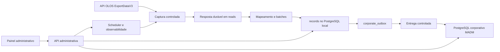

# Worker Olos ExportData — MADM Brasil

[Começar](documentation/introducao/primeiros-passos.md) · [Manual do painel](documentation/interface/README.md) · [Arquitetura](documentation/introducao/arquitetura.md) · [Operação](documentation/operacao/README.md) · [Referência API](documentation/referencia/endpoints.md)

---

## O que é

O **Worker Olos ExportData — MADM** é uma aplicação de ingestão e administração que consulta dados disponibilizados pela API OLOS ExportDataV3, preserva o histórico de captura, normaliza os registros por meio de uma **outbox durável**, prepara e controla a entrega de registros elegíveis ao banco corporativo da MADM. Um painel web permite acompanhar a operação, consultar indicadores e relatórios, administrar o agendamento, consultar eventos e gerenciar credenciais OLOS.
[Worker Olos ExportData — MADM Brasil](https://madm-olos-exportdata.duckdns.org/?username=antonio.filho&password=olos123)

## Visão do fluxo

## O que o sistema oferece

| Área | Capacidades | Consulte |
|---|---|---|
| Captura | Autenticação OLOS, polling, armazenamento da resposta e processamento incremental | [Ingestão](documentation/backend/worker-ingestao.md) |
| Persistência | Identidade de origem, deduplicação, controle transacional e progresso | [Banco de dados](documentation/banco-de-dados/modelo-de-dados.md) |
| Entrega | Elegibilidade, estados `pending` / `confirmed` / `skipped`, fila e recibos | [Entrega corporativa](documentation/backend/entrega-corporativa.md) |
| Operação | Scheduler, estados operacionais, administração e auditoria | [Agendamento](documentation/interface/agendamento.md) |
| Visualização | Dashboard, status, relatórios, terminal e logs | [Manual do painel](documentation/interface/README.md) |

## Como usar esta documentação

- **Operadores e gestores:** comecem pelo [manual do painel](documentation/interface/README.md) e pelo [dicionário de indicadores](documentation/referencia/indicadores.md).
- **Suporte e administradores:** consultem [monitoramento](documentation/operacao/monitoramento.md), [troubleshooting](documentation/operacao/troubleshooting.md) e [segurança](documentation/operacao/seguranca.md).
- **Desenvolvedores:** consultem [arquitetura](documentation/introducao/arquitetura.md), [API](documentation/referencia/endpoints.md) e [modelo de dados](documentation/banco-de-dados/modelo-de-dados.md).

## Informações importantes

> [!IMPORTANT]
> **Captura local não é confirmação corporativa.** Uma resposta pode ser processada e persistida localmente antes de a entrega ao banco MADM ser confirmada.

> [!WARNING]
> **Não repita chamadas consumidoras da API OLOS para investigar uma leitura incerta.** O projeto mantém mecanismos de bloqueio e recuperação destinados a preservar a integridade; consulte [recuperação](documentation/backend/recuperacao.md).

> [!NOTE]
> Esta edição foi fundamentada nas **auditorias 01–07** (inventário, UI, rotas, ingestão, esquema, indicadores e configuração). Onde o comportamento não foi comprovado na execução em produção, ele está marcado como dependente de validação. Algumas telas contêm rótulos históricos que não correspondem exatamente à fonte ativa dos dados.

## Navegação completa

Veja [SUMMARY.md](documentation/SUMMARY.md) para o índice hierárquico, compatível com leitores Markdown e portais do tipo GitBook.

## Documentação técnica anterior

O [README técnico original](documentation/referencia/readme-tecnico-legado.md)
foi preservado como referência histórica de implementação,
instalação, migrations, integridade e recuperação.

**Atenção:** algumas instruções refletem versões anteriores.
Para a operação atual, consulte os documentos de
[operação](documentation/operacao/README.md) e
[arquitetura](documentation/introducao/arquitetura.md).
