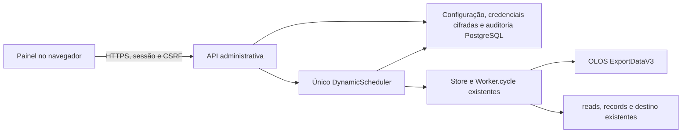

# Agendamento dinâmico e administração OLOS

Implementação preparada e validada localmente. **Não publicada.** Nenhum container operacional foi reiniciado, nenhuma credencial existente foi modificada e nenhuma migration foi aplicada no banco operacional.

## Auditoria e arquitetura

O checkout tinha um CLI, `sequentialPolling()` com intervalo fixo, `Worker.cycle()`, `Store` com advisory lock por fonte, intenção de leitura, staging, deduplicação e recuperação. Não havia frontend, servidor HTTP administrativo ou identidade web. As alterações locais de baseline e captura de recuperação encontradas no checkout foram preservadas.

A implementação adiciona um único agendador dinâmico, utilizado pelo comando `start` ou pelo comando `admin`. **São modos alternativos do mesmo serviço, nunca dois consumidores em paralelo.** O `Worker.cycle()` existente continua sendo o único caminho de ingestão incremental. O painel não controla Docker e não chama endpoints transacionais diretamente. `sequentialPolling()` permanece disponível para compatibilidade/testes, mas o CLI `start` utiliza `DynamicScheduler`.



Backend: Node HTTP + TypeScript e `pg` já presentes. Frontend: HTML/CSS/JavaScript servido pelo mesmo backend, sem build/framework adicional. Sem novos pacotes no runtime, filas, cron ou serviços de ingestão adicionais. Prisma permanece exclusivo do laboratório local existente.

Arquivos principais:

- `src/scheduler.ts`: único laço, admissão sequencial, estado e interface `request(actor, patch)` / `status()`.
- `src/admin/repository.ts`: configurações, lock administrativo, auditoria transacional, controle de revisão e consultas de metadados.
- `src/admin/consumer.ts`: adapta o consumidor existente, verifica todas as pendências e troca credenciais somente entre ciclos.
- `src/admin/credentials.ts`: criptografia e teste não transacional.
- `src/admin/security.ts`, `server.ts`, `main.ts`: login, autorização, HTTP e ciclo de vida.
- `admin/public/`: painel com Dashboard, Logs, Agendamento, Credenciais OLOS e Status operacional.
- `admin/migrations/002_worker_administration.sql`: migration manual, incremental e idempotente.
- `compose.admin.yaml`: override opcional do **mesmo serviço worker**, preservando `restart: "no"`.

## Persistência e semântica do agendamento

`olos_http.worker_settings` tem uma linha por `OLOS_SOURCE_KEY`: `enabled`, `interval_ms`, `updated_at`, `updated_by`, estado desejado, estado de execução e último código de erro. `enabled` deve concordar com o estado desejado. A tabela de credenciais guarda o payload inteiro criptografado e sua revisão. `admin_audit` guarda somente ator, ação, horário e metadados permitidos, sem valores de credenciais.

O primeiro startup usa `POLL_INTERVAL_MS` para inicializar uma linha ausente. Uma linha existente nunca tem intervalo/pausa/parada sobrescritos pelo `.env`. O intervalo precisa estar entre 60.000 e 3.600.000 ms; o exemplo usa 120.000 ms. A interface oferece minutos inteiros de 1 a 60, incluindo 1, 2, 3 e 5. O serviço aceita qualquer intervalo inteiro em ms dentro desses limites.

O comando `start`, em uma origem ainda sem configuração, solicita execução. O primeiro `admin`, em uma origem sem configuração, inicia com consumidor **STOPPED**. Se já existir configuração, ambos a respeitam. Nenhuma migration é executada automaticamente. Banco/tabela indisponível não autoriza voltar silenciosamente ao `.env`, pois isso poderia ignorar uma pausa persistida.

O agendador consulta a configuração a cada até 1 segundo durante espera/pausa/parada, e antes de admitir o próximo ciclo. Solicitações pela API acordam a espera imediatamente. Não consulta configurações no meio do HTTP ou de um lote SQL. A próxima execução é calculada a partir do **fim do ciclo anterior**; reduzir o intervalo pode tornar a execução imediatamente elegível se esse prazo já tiver transcorrido. Aumentar o intervalo adia a leitura. Ao retomar de uma pausa longa, a leitura pode ser imediatamente elegível.

Backoff preserva o contador limitado, `Retry-After` e a classificação de falhas do worker. Diminuir intervalo não reduz um backoff já estabelecido. Erro não retentável/ambíguo ou esgotamento de tentativas entra em `ERROR`. No modo CLI, o processo termina com erro; no modo web, painel/API permanecem disponíveis. Reinício após estado ativo não concluído fica em `ERROR` e exige ação administrativa; não é apresentado como parada voluntária.

## Estados operacionais

| Estado | Significado |
|---|---|
| RUNNING | Consumidor validado, agendador habilitado; pode estar aguardando intervalo/backoff |
| PAUSING | Pausa registrada, ciclo ativo ainda concluindo |
| PAUSED | Nenhum ciclo novo; consumidor já aberto e seu lock são mantidos |
| STOPPING | Parada registrada, aguardando conclusão do ciclo e fechamento de HTTP/Store |
| STOPPED | Consumidor encerrado, lock de consumo liberado; painel/API continuam disponíveis |
| ERROR | Falha inesperada, preflight rejeitado ou incerteza; sem novas leituras automáticas |

Uma solicitação de início responde **202**, que significa solicitação registrada, não validação concluída. O estado só passa a `RUNNING` após preflight. Durante abertura inicial pode aparecer `STOPPED` com estado solicitado `RUNNING`; ainda não há ciclo ativo. Falha de lock, fonte não confirmada, baseline/fuso ausentes ou qualquer `reading`/`received` pendente bloqueia o início. Não há `drain()` administrativo, bypass, descarte de captura ou resolução automática.

O lock do agendador impede dois controladores da mesma fonte neste banco. O lock original de `Store` continua impedindo dois consumidores, inclusive CLI antigo e painel. Esses locks **não** coordenam Postman ou consumidores ligados a outro banco. O painel mostra o consumidor que ele gerencia, não inventaria processos externos. Na publicação deve existir apenas uma instância e o consumidor antigo deve ser encerrado com evidência.

Pausa/parada não abortam HTTP nem transações. Sinais SIGTERM/SIGINT no novo agendador também aguardam a operação corrente e persistem a parada. Perda inesperada da sessão PostgreSQL mantém o comportamento conservador de abortar HTTP e exigir reconciliação. SIGKILL, queda do host ou expiração do grace period podem deixar intenção ambígua; não há promessa de perda zero. Por isso a publicação deve primeiro aguardar `STOPPED`, antes de encerrar o container.

Eventos estruturados: `scheduler_started`, `scheduler_interval_changed`, `scheduler_paused`, `scheduler_resumed`, `scheduler_next_run`, `poll_retry` e `scheduler_error`. Auditoria registra o administrador que solicitou a ação; mudanças efetivas de estado ficam com ator `system:scheduler`.

## Credenciais e autenticação administrativa

O acesso usa exclusivamente **Usuário OLOS + Senha OLOS**. O backend autentica com um `HttpTransport` e `OlosAuthManager` novos, apenas em `POST /api/auth`, usando Client ID/Secret da configuração protegida. Não reutiliza, renova ou invalida o manager de ingestão. A senha submetida não é gravada na sessão, no banco, em arquivos ou em logs; o frontend limpa o campo ao enviar. Nenhum token OLOS é devolvido ao navegador.

`ADMIN_OLOS_USERS_JSON` contém somente uma lista de identidades OLOS autorizadas, por exemplo `["olos.administrador"]`. A identidade é o nome exato aceito pelo password grant, sem assumir permissões por autenticação bem-sucedida, aliases ou diferença de caixa. Quem autentica, mas não está na lista, recebe acesso negado. Não há mais cadastro de senha administrativa, `ADMIN_USERS_JSON` ou geração de hashes locais. A lista deve ser definida pelo responsável; não se promove automaticamente o usuário técnico da integração.

- Sessões em memória, expiração de 8 horas, HttpOnly/SameSite=Strict e Secure em HTTPS. Reinício invalida sessões. CSRF em memória, Origin exata, limite de tentativas de login, confirmação de parada e auditoria permanecem obrigatórios.
- HTTPS é obrigatório fora de loopback. HTTP em `localhost:8081` é exclusivo da homologação simulada. Não expor o painel HTTP diretamente à Internet.
- A tela de credenciais mostra URL, usuário configurado, existência da senha, configuração completa/incompleta e último teste. **Client ID/Secret não aparecem em respostas nem em campos de edição.** Tentativas de alterá-los pela API comum são rejeitadas; gestão técnica permanece no backend.
- Valores iniciais vêm do `.env`. Configuração cifrada já existente tem precedência. Salvar conserva senha/segredos omitidos; senha vazia também preserva a anterior. O `.env` não é modificado. Alterar a conexão não autentica automaticamente nem interrompe o ciclo ativo.
- AES-256-GCM com nonce aleatório e associação autenticada à fonte; chave `ADMIN_ENCRYPTION_KEY` com 32 bytes hex fora do banco. Revisão impede sobrescrever edição concorrente. Auditoria e gravação são atômicas, sem valores secretos.
- O teste da configuração salva consulta **somente `/api/auth`**. Resultado de uma revisão antiga não valida revisão nova. O login web não salva suas credenciais como credenciais de ingestão.
- `ADMIN_OLOS_ALLOWED_ORIGINS` restringe a origem e `/WebApiExportData`. TLS permanece verificado por padrão; a exceção existente afeta apenas OLOS, nunca PostgreSQL ou outros clientes.
- A independência dos clientes é comprovada localmente. Uma eventual política da OLOS de revogar tokens de outras sessões ao autenticar depende do servidor e precisa de homologação real autorizada; não se chama nenhum endpoint de revogação.

Consultar [homologação do login OLOS](homologation-login.md) para resultados, perfil local isolado e comandos exatos de reinício na porta 8081.

## Indicadores e evidências

`GET /api/status` separa a autenticação da sessão, conectividade/estrutura PostgreSQL e ingestão. O preflight do dashboard usa transação **somente leitura**, sem abrir `Store` consumidor ou adquirir seu lock. Banco acessível com destino ausente é mostrado como estrutura inválida, mesmo após login válido.

O dashboard exibe estado real/desejado, intervalo, última leitura, próxima execução, recebidos, inseridos, duplicidades, duração, último erro e pendências. Contagens de inserção/duplicidade/duração são publicadas em auditoria após `Worker.cycle()` concluir a persistência existente. A gravação da evidência verifica `reads.state='done'`, origem, progresso e quantidade. Nenhum mapeamento ou SQL de destino foi alterado.

O último ciclo confirmado é recuperado de `reads`, com as métricas correspondentes em `admin_audit`. Histórico anterior sem medição recebe NULL/“Não medido”, nunca zero inventado. Ciclo confirmado com array vazio continua válido: ausência de novas chamadas não é falha de conexão. Capturas `reading`/`received` permanecem pendentes, sem alegar persistência final. Se a gravação da telemetria falhar depois do commit de dados, o agendador entra em ERROR sem repetir o consumo; `reads` preserva a conclusão, e métricas ausentes continuam não medidas. Há uma janela residual entre commit de dados e evidência administrativa, sem promessa de atomicidade entre ambos.

## API administrativa

| Rota | Operação |
|---|---|
| POST /api/login | Cria sessão administrativa |
| GET /api/session; POST /api/logout | Sessão/CSRF e encerramento |
| GET /api/status | Estado real/desejado e evidências separadas de autenticação, PostgreSQL e ingestão |
| PATCH /api/schedule | `{ "interval_ms": 180000 }` |
| POST /api/worker/pause, /resume, /start | Registra intenção administrativa, `{}` |
| POST /api/worker/stop | Exige `{ "confirm": true }` |
| GET /api/credentials | Configuração pública, existência de segredos e último teste |
| PUT /api/credentials | Salva URL/usuário/senha editáveis e `revision` esperada; segredos técnicos ficam internos |
| POST /api/credentials/test | Testa a configuração salva, sem consumo |
| GET /api/logs; GET /api/audit | Até 100 registros de metadados |

Exceto login e assets estáticos, todas as rotas exigem sessão administrativa; escritas exigem CSRF/Origin. Não existe endpoint de consumo, recuperação transacional ou SQL arbitrário. A interface de serviço fica em `DynamicScheduler`, `CredentialService` e `AdminRepository`; futuros frontends devem reutilizar essa autorização, não conectar diretamente à OLOS ou PostgreSQL.

## Publicação controlada — não executada

1. Revisar este diff e os resultados abaixo. Identificar imagem anterior, configuração de runtime, fonte, banco e papel corretos. Fazer backup privado das tabelas de controle e das credenciais/chave fora do banco. Não executar este procedimento sem autorização operacional.
2. Homologar com banco isolado e fonte simulada. A migration pressupõe `olos_http` existente. Revisar permissões do papel: SELECT/INSERT/UPDATE em `worker_settings`/`admin_credentials`, SELECT/INSERT em `admin_audit`, USAGE na sequência de auditoria. Manter permissões já existentes do Store; o painel não remove constraints nem altera a tabela destino.
3. Em janela aprovada, garantir encerramento do consumidor atual e conferir leituras pendentes. O CLI antigo ainda aborta HTTP em SIGTERM: não encerrar durante um ciclo; coordenar a janela e reconciliar qualquer intenção pendente antes da troca. A nova pausa/parada só existirá após publicar este código.
4. Aplicar **manualmente**, usando conexão administrativa privada já aprovada, somente:

   ```bash
   psql -X -v ON_ERROR_STOP=1 -f admin/migrations/002_worker_administration.sql
   ```

   Este comando depende da conexão previamente configurada de forma privada. Não colocar URL/senha na linha de comando. A migration é idempotente e não toca `raw.olos_calls`, `olos_http.reads` ou `olos_http.records`. Não executá-la indiscriminadamente em outro banco.

5. Configurar as variáveis de `admin/.env.example` no Dokploy/secret manager, com `ADMIN_ORIGIN` igual à origem HTTPS do painel. Preservar todas as variáveis OLOS atuais. Manter uma réplica e `restart: "no"`. O override substitui o comando do **mesmo serviço**, não cria uma segunda instância:

   ```bash
   # Alternativa local ao painel Dokploy, somente quando a publicação estiver autorizada:
   docker compose --env-file .env --env-file admin/.env -f compose.yaml -f compose.admin.yaml build worker
   docker compose --env-file .env --env-file admin/.env -f compose.yaml -f compose.admin.yaml up -d --no-deps worker
   ```

   No Dokploy, apontar o domínio HTTPS para a porta interna 8080. Para proxy em container, usar a rede interna da plataforma; a publicação 127.0.0.1:8080 do exemplo é somente acesso local do host, não porta pública. Não publicar HTTP administrativo diretamente na Internet.

6. Confirmar no painel a configuração inicial `STOPPED`, ou o estado persistido da origem caso já exista. Confirmar login/CSRF, teste OLOS sem consumo, auditoria e ausência de segredos nas respostas. Somente sob autorização de consumo usar Iniciar. Validar `RUNNING`, um único consumidor e primeiro lote; testar pausa durante ciclo e alteração de intervalo. Parada só é concluída quando o painel mostra `STOPPED`.
7. Monitorar `ERROR`, pendências, duração das gravações e limite de tentativas. O override tem grace period de 10 minutos como margem, mas ele não substitui aguardar `STOPPED`: o ciclo pode durar mais dependendo do volume.

## Rollback

1. No novo painel, solicitar Parar e aguardar `STOPPED`, ciclo inativo e fechamento do consumidor. Se houver `ERROR`/leitura ambígua, preservar a evidência e reconciliar antes de qualquer retomada. Não apagar controles para liberar o worker.
2. Encerrar o novo serviço e restaurar a imagem anterior e seu comando/configuração em janela autorizada. Nunca executar versões antiga/nova como consumidores simultâneos.
3. **A versão anterior não conhece a parada persistida nem credenciais salvas pelo painel.** Publicá-la inicialmente com `WORKER_COMMAND=check`. Revalidar as credenciais antigas preservadas no `.env`, confirmar intervalo esperado e estado transacional. Reativar `start` antigo somente com autorização explícita; rollback não autoriza retomar consumo automaticamente.
4. Manter as novas tabelas e auditoria; o código anterior as ignora. Não executar DROP como parte do rollback. Guardar a chave AES e backups enquanto houver ciphertext armazenado. Alterações posteriores de credenciais na OLOS podem ter invalidado o `.env` antigo; não assumir que ele continua válido.

## Validação executada

Node 24.16.0; nenhum acesso real à OLOS. Nenhum acesso ao banco operacional. PostgreSQL 16 descartável criado apenas para testes, removido ao final.

| Verificação | Resultado |
|---|---|
| Typecheck/build | Aprovados |
| Unidade, HTTP local, segurança e scheduler | 64 testes aprovados |
| Administração em PostgreSQL descartável | 13 testes aprovados |
| Regressão PostgreSQL do worker existente | 23 testes aprovados |
| Migration repetida e transações/auditoria | Aprovadas no banco descartável |
| Build Docker de produção | Aprovado; imagem local de validação |
| Navegador Chromium, fixtures | Login, intervalo, credenciais, teste seguro, confirmação/estado de parada, logs, logout e layout móvel aprovados |

```bash
npm run typecheck
npm test
npm run build
bash scripts/test-admin.sh
bash scripts/test-integration.sh
```

O smoke de navegador é `test/admin.browser.mjs`, com Playwright instalado fora do projeto (`ADMIN_PLAYWRIGHT_PATH`) e Chromium (`ADMIN_CHROMIUM_PATH`, opcional). Ele acessa exclusivamente `http://localhost:8081` no perfil simulado de homologação, usa o PostgreSQL local e a API fictícia de autenticação, sem carregar `.env` operacional. A captura opcional usa `ADMIN_SCREENSHOT`.

Ainda dependem de homologação autorizada: papel/permissões reais, reverse proxy/HTTPS do Dokploy, fornecimento e backup da chave AES, contas administrativas reais, troca controlada do processo e testes de volume/grace period. Não há integração SSO nesta entrega. Nenhuma garantia distribuída foi adicionada à janela entre consumo OLOS e persistência local.
