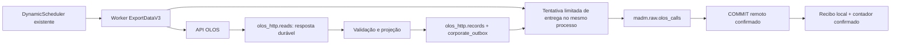

# Persistência corporativa no processo ExportDataV3

Esta implementação adapta o **mesmo processo** `dist/main.js start/admin/once`. O `DynamicScheduler` existente continua sendo o único agendador da captura OLOS. `src/corporate-delivery/` contém componentes auxiliares do Store; não tem entrada executável, timer, scheduler, worker, Compose ou container próprios. O Corporate Sync antigo é preservado, mas não é importado/iniciado pelo fluxo operacional.

## Fluxo implementado



`DATABASE_URL` continua apontando ao banco local. Não são gravadas novas chamadas em `raw.olos_calls` local no modo corporativo: o lote vem da resposta OLOS preservada em `olos_http.reads`, é validado e entra diretamente na outbox. A tabela local antiga é lida somente na conciliação inicial e sua sequência original continua alocando os IDs internos. Não existe polling da tabela local para replicação.

`reads.state='done'` e `processed_count` confirmam **validação e admissão durável local**, não entrega corporativa. `CorporateDelivery` confirma `corporate_outbox.state='confirmed'`, `remote_raw_id`, `confirmed_at` e o contador em `corporate_control` somente depois do COMMIT remoto confirmado. Os relatórios de captura usam `queued`, mantendo `inserted=0` para filas; o painel expõe `corporate_delivery` separadamente da captura.

Ao terminar cada ciclo do Worker, uma tentativa limitada pode entregar um lote pendente. Não há outro loop/timer de entrega. Essa tentativa usa conexão local separada da captura, uma conexão MADM própria e promessa acompanhada pelo Store; não bloqueia o próximo ciclo de captura. Uma tentativa ainda ativa impede outra no mesmo Store. Pausa/desligamento aguardam essa promessa antes de liberar o lock da origem.

O avanço da fila após autenticação OLOS indisponível pode ocorrer nos ciclos que o agendador existente ainda admite. Se esse agendador entrar em ERROR/STOPPED, a entrega não ganha um agendador alternativo: recuperar explicitamente pelo processo existente ou pelo comando pontual autorizado.

## Contrato MADM

- Banco obrigatório `madm`; destino fixo `raw.olos_calls`.
- `internal_id_olos integer`, UNIQUE parcial `WHERE internal_id_olos IS NOT NULL`.
- `raw_olos_call_id bigint GENERATED ALWAYS AS IDENTITY`, PK automática.
- `telefone_match_key` produzido pelo trigger corporativo; datas de carga/criação/atualização seguem defaults corporativos.
- O INSERT omite `raw_olos_call_id`, `telefone_match_key`, `kommo_*` e colunas de defaults corporativos.
- Não existe UPDATE/DELETE corporativo nem `ON CONFLICT DO UPDATE` nesse caminho.

Reutiliza as regras puras de `src/corporate-sync/mapping.ts` e o schema corporativo já descrito em `src/corporate-sync/schema.ts`. Valida PK, índice parcial, disponibilidade dos índices, identity ALWAYS, tipos, nulabilidade, comprimentos, defaults, trigger e funções de normalização. Na conciliação inicial persiste uma impressão do schema e das duas funções; divergências posteriores bloqueiam a entrega antes de INSERT. Nenhuma incompatibilidade é corrigida por DDL corporativo.

A identidade lógica continua sendo `(CallId, data_ligacao, telefone, campanha)`. Comparar o ID interno isoladamente ou apenas CallId é insuficiente. Antes de inserir, busca tanto o ID interno quanto a identidade composta. Se existir a mesma identidade em outro ID, ou o mesmo ID com outra chamada, bloqueia. Mesmo identidade/ID iguais exigem igualdade de todos os campos transferidos. `kommo_*`, campos automáticos e telefone normalizado não entram nessa igualdade.

Chamadas já idênticas são reconhecidas sem novo INSERT, sem executar novamente seu trigger e sem consumir outro valor da identity corporativa. Para linhas ausentes usa `ON CONFLICT (internal_id_olos) WHERE internal_id_olos IS NOT NULL DO NOTHING`; revalida o resultado na mesma transação SERIALIZABLE, nunca presume que o conflito é uma duplicata legítima.

A sequência **já existente** da tabela local é reutilizada via `pg_get_serial_sequence`. Não se cria sequência, não se executa setval, não se usa o ID OLOS como ID interno e não se realoca um registro após colisão. Valida a sequência contra os IDs locais já usados, rejeita ciclos/incrementos não positivos e valida cada novo ID no intervalo de integer. Outros produtores corporativos podem ocupar o mesmo espaço: nesse caso a comparação bloqueia o lote e preserva evidência, sem sobrescrever. Homologar a convivência e a capacidade restante desse espaço antes de ativar.

## TMA e tempo

A política `round-half-away` já foi aprovada no pedido e fica fixa neste modo, sem pedir uma nova aprovação de política:

| Valor | Inteiro corporativo |
| --- | --- |
| 0.001 / 0.49 / 0.499999 | 0 |
| 0.5 | 1 |
| 1.5 | 2 |
| -0.5 | -1 |

A duração das novas respostas OLOS é calculada em microssegundos e arredondada **uma vez** para integer. O comportamento anterior em centésimos permanece no modo local. Durações negativas ou dados ausentes mantêm a regra existente de NULL; limites de integer são verificados antes da entrega. O histórico conciliado usa sua projeção/recibo existente, sem recalcular e sobrescrever valores antigos.

`data_ligacao timestamptz` preserva o instante e os microssegundos. Se o destino real usar timestamp sem fuso, requer fuso explícito e `OLOS_CORPORATE_TIMESTAMP_CONFIRMATION=CONFIRM_TIMESTAMP_<fuso>`; a conversão é feita por `AT TIME ZONE`. Schema/precisão/fuso incompatíveis bloqueiam a ativação. O tipo temporal real não foi consultado nesta implementação.

## Como preservar os 12.605 registros

O novo padrão **12.605** vem da auditoria operacional da VPS informada pelo usuário, após o último lote legado de 500 registros ter concluído com sucesso via `once` do Corporate Sync. Os dados reportados são do banco local `olos_exportdata`, origem `olos-production`:

- `corporate_sync.control`: version 1, generation 27, last_confirmed_id 12605, confirmed_count 12605 e pending NULL.
- `corporate_sync.receipts`: 12605 recibos distintos, IDs de 1 a 12605.
- `olos_http.records`: 725284 registros rastreados.
- Sequência `raw.olos_calls_internal_id_olos_seq`: last_value 725284, is_called true.
- `olos_billing.sources`: 0 registros no momento da auditoria reportada; a proteção contra dependências Billing permanece ativa.

Essas informações foram fornecidas pelo usuário e não foram reconsultadas nesta atualização. Alterar o esperado não modifica checkpoints, recibos, sequência nem backlog. A regressão de **12.105 registros sintéticos** permanece preservada; o novo teste cobre 12.605 recibos e três registros sintéticos de backlog, sem simular o volume total de 725284 registros.

A conciliação administrativa é única, localmente transacional e exige evidência por registro:

1. Adquirir o lock original da origem OLOS e o advisory lock usado pelo Corporate Sync, impedindo os dois consumidores simultâneos.
2. Exigir ausência de capturas locais `reading`/`received` e de lote pendente em `corporate_sync.control`.
3. Confirmar o binding legado explicitamente configurado, `confirmed_count` e a contagem real dos recibos: devem corresponder ao esperado 12.605.
4. Relacionar cada recibo ao `target_id` de `olos_http.records`, preservando o `source_id` OLOS associado. O teste usa IDs de origem diferentes dos internos.
5. Projetar a chamada local, verificar seu hash contra o recibo e comparar identidade e campos transferidos com a chamada corporativa, em transação corporativa READ ONLY.
6. Adotar os recibos comprovados na nova outbox como confirmados, registrando a PK automática corporativa. Esses registros não são enviados novamente.
7. Migrar também registros históricos locais ainda sem recibo: se a chamada idêntica já existe no corporativo, reconhecê-la; caso contrário, preservar seu mesmo ID e projeção como pending. A transição não descarta o backlog.
8. Confirmar a transação remota de leitura e, somente depois, confirmar a transação local de adoção, schema e estado `ready`. A entrega continua pausada até comando explícito de retomada.

`corporate_sync.control`, `corporate_sync.receipts`, `olos_http.records`, respostas e checkpoints anteriores não são apagados ou reescritos. A migração local cria somente `olos_http.corporate_control`, `olos_http.corporate_outbox` e seu índice local. Repetir a conciliação depois de `ready` retorna o resultado persistido; não reinicializa fila nem recibos e não representa uma nova auditoria corporativa completa.

Hash diferente, mapping ausente, ID fora do intervalo, pendência antiga, chamada divergente/ausente, binding incompatível ou contagem inesperada impedem a adoção inteira. Não preencher recibos pela contagem, não inferir ID pelo CallId, não alterar o binding para passar e não ignorar registros problemáticos. Se o estado disponível não comprovar os 12.605, **a ativação deve ficar bloqueada**.

O estado persistente também impede iniciar novamente o Corporate Sync ou voltar acidentalmente ao modo de persistência local depois da transição. O código/serviço antigo não é removido nem iniciado por esta entrega.

Há uma incompatibilidade concreta com o Billing atual: `projectAttempts` verifica a presença do ID em `raw.olos_calls` **local** e marca conflito quando a chamada não existe ali. Por isso, se `olos_billing.sources.attempts_source` apontar para esta origem, a conciliação, admissão de captura, retomada e entrega direta bloqueiam com `BILLING_LOCAL_CALLS_DEPENDENCY`. Nenhum arquivo/configuração Billing é alterado. Se essa dependência existir em produção, manter a transição bloqueada até uma solução de contrato separadamente aprovada; não excluir/editar a configuração Billing para contornar a proteção. Auditar também consumidores locais externos ou ainda não registrados: a guarda não descobre automaticamente todos eles.

## Configuração e controles

O padrão permanece `ATTEMPTS_PERSISTENCE_MODE=local`. O modo novo é `corporate`, configurado no mesmo serviço ExportDataV3. Não reaproveita variáveis `CORPORATE_SYNC_*`. Ver [environment.example](environment.example), que não contém credenciais reais.

| Variável | Regra |
| --- | --- |
| `DATABASE_URL` | banco local existente; não trocar pelo MADM |
| `OLOS_CORPORATE_DATABASE_URL` | URL explícita, banco `/madm`, sem opções na query string |
| `OLOS_CORPORATE_CA_FILE` | CA corporativa montada somente leitura; opcional se a cadeia já for pública/confiável |
| `OLOS_CORPORATE_WRITE_ENABLED` | false por padrão |
| `OLOS_CORPORATE_WRITE_CONFIRMATION` | `AUTHORIZE_EXPORTDATA_DIRECT_DELIVERY` para habilitar escrita |
| `OLOS_CORPORATE_LEGACY_BINDING` | binding exato já existente em corporate_sync.control |
| `OLOS_CORPORATE_LEGACY_EXPECTED_COUNT` | 12605 por padrão; mudanças exigem evidência/decisão explícita |
| `OLOS_CORPORATE_RECONCILE_CONFIRMATION` | `AUTHORIZE_CORPORATE_STATE_RECONCILIATION` para adoção administrativa local |
| `OLOS_CORPORATE_BATCH_SIZE` | 250, entre 1 e 2000 |
| `OLOS_CORPORATE_TIMEOUT_MS` | 15000, conexão/statement/lock |
| `OLOS_CORPORATE_BACKOFF_MS` | 1000; backoff exponencial até 60 segundos |
| `OLOS_CORPORATE_MAX_FAILURES` | 5; após o limite, bloqueia somente entrega até retomada explícita |
| `DB_POOL_MAX` | precisa ser pelo menos 2 no modo corporativo |

TLS corporativo sempre valida certificado e hostname. Não há opção para desabilitar SSL/validação; `OLOS_CORPORATE_TLS_VERIFY=false` é rejeitado. Nunca colocar credenciais no código, comandos de teste, logs ou Git. A conexão local segue a configuração operacional existente.

Comandos adicionados ao **mesmo** `dist/main.js`, sem autenticar/consumir OLOS:

| Comando | Uso |
| --- | --- |
| `corporate-status` | contagens/estado locais, sem conexão MADM |
| `corporate-check` | valida binding e schema atual em leitura; exige estado conciliado |
| `corporate-reconcile` | concilia/adota o legado; requer origem parada, confirmações e leitura MADM |
| `corporate-pause` | pausa somente entrega; captura pode continuar |
| `corporate-resume` | retoma entrega com autorização; pode rearmar falha transitória/COMMIT incerto após esgotar tentativas |
| `corporate-deliver-once` | uma tentativa de um lote, respeitando pausa/backoff; exige o lock da origem e não concorre com o serviço ativo |

Status/check/pause/resume usam uma conexão de controle local independente e podem operar com o worker ativo. Pausa espera a transação de entrega atual terminar antes de retornar; não abandona um commit em curso. Um bloqueio estrutural, de identidade ou payload não é apagado por resume. Requer investigação e resolução com evidência, fora de um mecanismo automático de “pular erro”.

Pausar o agendador existente suspende admissão de novas entregas e espera a atual; retomar o agendador respeita a pausa persistida da entrega. Parar/desligar fecha os recursos depois da confirmação em andamento. SIGKILL/timeout do container pode interromper esse caminho; a recuperação usa a outbox persistida. Dimensionar o grace period para o lote, latência e timeouts antes de homologar operação.

## Falhas, recuperação e limites

- Falha corporativa não altera a resposta OLOS já persistida e não transforma o ciclo em erro de captura. A fila continua recebendo chamadas; tentativas e backoff ficam no controle de entrega.
- Falha antes do COMMIT remoto: não há confirmação local; revalida e tenta o mesmo payload depois.
- Falha ao confirmar COMMIT, inclusive desconexão sem SQLSTATE: registra `CORPORATE_COMMIT_UNKNOWN`. Pending significa resultado ainda não comprovado localmente, e não necessariamente ausência no corporativo.
- Falha depois do COMMIT remoto e antes/durante o COMMIT local: o payload fica pending ou já confirmado, conforme o resultado local. O reinício lê esse estado e reconhece somente a chamada corporativa exata. Não há transação distribuída atômica.
- Falha local ou perda do dono do lock continua sendo fatal para a captura, conforme o protocolo anterior. Não mascarar essa falha como simples indisponibilidade corporativa.
- Retentativas são acionadas pelos ciclos já admitidos e respeitam `next_attempt_at`, calculado pelo PostgreSQL local. Não há novo scheduler nem retry automático de uma leitura consumptiva OLOS incerta.
- A implementação replica inserções, não alterações posteriores. Payloads ficam congelados; enriquecimentos posteriores não modificam chamadas corporativas existentes.
- A fila não tem descarte automático. Provisionar capacidade local, monitorar pending, tentativas, duração e crescimento de respostas/outbox. Uma indisponibilidade longa pode consumir disco; falta de capacidade local exige intervenção operacional.
- Restauração corporativa anterior aos recibos locais exige reconciliação coordenada. O código não presume que chamadas confirmadas continuam existindo após restauração externa nem apaga recibos para reenviar.
- Não existe garantia de unicidade lógica contra outros escritores que não participam deste protocolo. O índice corporativo protege IDs internos; diferenças e colisões observadas bloqueiam.

Logs têm somente eventos, contagens, tentativas, duração/códigos fixos e UUIDs de captura já usados no worker. Sem credenciais, SQL, detalhes de erro PostgreSQL, CPF, e-mail, telefone ou conteúdo de payload. Respostas e outbox locais contêm dados pessoais necessários à recuperação: proteger acesso, disco e backups.

## Validação da release sem Billing

O Corporate Delivery não importa arquivos de `src/billing/` nem exige suas migrations. A guarda de compatibilidade consulta a existência de `olos_billing.sources` e só verifica dependências se essa tabela já existir; sua ausência não impede o funcionamento. O teste dessa guarda cria uma fixture mínima própria, sem carregar o módulo Billing.

Com Node 24 e dependências instaladas, executar `npm run typecheck`, `npm run build` e `node --import tsx --test test/corporate-delivery.test.ts`. O comando `bash scripts/test-corporate-delivery.sh` provisiona PostgreSQL descartável e executa integração Corporate Delivery, regressões Store e administração. Não provisiona nem executa a suíte Billing. Antes de criar bancos, verifica rede interna, ausência de portas publicadas e identidade do container temporário; ao terminar remove container, dados e rede. Não usa URLs reais do ambiente. A fixture inclui os cenários legados de 12105 e 12605 registros.

Para validar uma publicação seletiva, exportar somente o índice Git para um diretório vazio com `git checkout-index --all --prefix=<diretório-absoluto>/`, instalar dependências ali e executar os comandos nesse diretório. Construir a imagem com o Dockerfile existente a partir desse mesmo snapshot. Não copiar arquivos não staged do checkout original, ambientes reais ou artefatos `dist` anteriores.

## Homologação e ativação futuras — não executadas

1. Executar os testes descartáveis e revisar o relatório. Não usar bancos reais para testes/falhas injetadas.
2. Em janela separadamente autorizada, confirmar a identidade dos serviços/bancos, fazer backup de respostas, `records`, controles/recibos antigos, sequência e configuração. Verificar dependências do Billing e de outros consumidores da tabela local; a dependência Billing registrada bloqueia a transição. Não modificar o Environment do Dokploy durante esta implementação.
3. Parar de forma controlada a captura e o Corporate Sync anterior. Não iniciar o Sync separado para este fluxo. Resolver leituras/pending antigos pelo procedimento vigente antes de trocar de modo; não apagar evidências.
4. Aplicar manualmente **somente no banco local** `migrations/002_corporate_delivery.sql`, com identidade autorizada. Não há migration corporativa. Verificar que o runtime já possui permissões necessárias; não executar GRANT corporativo por este código.
5. Preparar a configuração do mesmo serviço com modo corporate, URL/CA explícitas, binding legado e contagem esperada, ainda com escrita false. Confirmar tipo temporal/fuso reais.
6. Com autorização específica de leitura corporativa e adoção local, executar `node dist/main.js corporate-reconcile`. Se falhar qualquer prova, manter a ativação bloqueada. Não substituir o esperado por uma contagem conveniente.
7. Executar `corporate-status` e `corporate-check`. Revisar 12.605 adotados, backlog, schema, trigger, PK, TMA, capacidade de IDs, TLS, planos de consulta, latência e coexistência com escritores corporativos. A fixture não certifica o schema real.
8. Somente com autorização de escrita, habilitar as duas variáveis de escrita e executar `corporate-resume`. Homologar um lote pequeno pelo processo existente; conferir PK automática, normalização, campos Kommo, recibos e ausência de duplicação. Esses passos escrevem dados reais e não foram executados aqui.
9. Retomar o agendador atual, acompanhar captura e entrega separadamente e dimensionar o lote sem criar outro serviço ou scheduler.

Rollback operacional seguro: pausar entrega e/ou parar o mesmo worker, manter o modo/configuração coerente com o estado adotado e preservar outbox/recibos. Não voltar simplesmente ao modo local nem reiniciar o Sync antigo; as proteções impedem esse retorno porque ele pode perder IDs/entregas pendentes. Retorno ao protocolo antigo exige plano específico de conciliação. Não deletar chamadas MADM, não executar down migration e não limpar o marcador de ownership para contornar o bloqueio.

## Entrega administrativa seletiva (até três registros)

`corporate-deliver-selected` usa o mesmo Store e Corporate Delivery, com seleção
exclusiva por `(source_key, source_id)`. Não chama `tick()` para drenar a fila,
`resume()`, API OLOS, migração ou agendador. A autorização vale apenas para a lista
literal informada. Não autoriza publicação, deploy nem execução operacional.

Pré-condições para uma **futura janela separadamente revisada e autorizada**:

1. Usar a versão revisada no serviço existente, com o consumidor parado para
   liberar o lock da origem. Não iniciar outro worker ou Corporate Sync.
2. Preservar a configuração de destino, binding, CA/TLS e contrato temporal já
   conciliados. Exigir `ready=true`, `paused=true`, `blocked=false` e
   `OLOS_CORPORATE_WRITE_ENABLED=false`. Aplicar previamente, apenas no banco local
   e em janela autorizada, `migrations/003_selective_commit.sql`. O comando não
   executa migrations nem modifica configurações de ambiente. O papel local da
   aplicação precisa de SELECT/INSERT/UPDATE na nova tabela; conceder privilégios
   explicitamente na implantação revisada, sem ampliar o papel corporativo.
3. Verificar ausência de captura histórica ativa ou intenção histórica pendente
   (`reading`/`received`). Não descartar intenções para liberar a entrega.
4. Conferir localmente os três mappings abaixo, hashes e payloads congelados;
   registrar a contagem pendente e evidência dos itens fora da seleção antes/depois.
   Os valores foram fornecidos pelo solicitante; não foram auditados no ambiente real.

| source_id | target_id | payload.olos_call_id |
| --- | --- | --- |
| 35091119 | 725285 | 35458016 |
| 35091120 | 725286 | 35458017 |
| 35091121 | 725287 | 35458018 |

Comando proposto, **não executado em ambiente real**. Pressupõe as variáveis
operacionais corretas já carregadas no processo, sem exportar nova autorização geral:

```sh
env OLOS_CORPORATE_WRITE_ENABLED=false \
  node dist/main.js corporate-deliver-selected \
  --source-ids 35091119,35091120,35091121 \
  --confirm AUTHORIZE_EXPORTDATA_SELECTIVE_DELIVERY:35091119,35091120,35091121
```

O formato é estrito: entre um e três inteiros positivos canônicos de até 64 bits,
sem repetição, espaços, intervalos ou argumentos adicionais. A confirmação deve
conter a mesma lista na mesma ordem. Autorização ausente/incorreta falha antes de
abrir conexões. A autorização geral `AUTHORIZE_EXPORTDATA_DIRECT_DELIVERY` não
substitui essa confirmação; escrita geral habilitada também bloqueia o comando.

O Store mantém os locks de origem e Corporate Sync. A transação toma o lock
exclusivo de entrega `(17320914,4)`, também usado por `tick()`, além do lock
compartilhado de captura histórica. Na entrega seletiva esses locks são de sessão
e sobrevivem ao COMMIT local da intenção. Control e recibos
são bloqueados sem espera na seleção. Nenhum caminho usa `SKIP LOCKED`: um item
ocupado, ausente, divergente ou inválido impede o conjunto. `origin` deve ser
`capture`, e o mapping de cada recibo deve coincidir com `olos_http.records`.

O estado `paused` permanece verdadeiro durante a transação e após ela; não existe
janela temporária de retomada. Os mesmos contratos de schema, hash, identidade
composta, deduplicação, TLS e campos corporativos gerenciados continuam válidos.
Todos os registros selecionados são validados antes do primeiro INSERT. Se a
escrita falhar, toda a transação remota é desfeita quando isso ainda for possível.
Recibos locais são confirmados somente após o COMMIT remoto reconhecido ou após
reconciliação explicitamente autorizada com prova remota idêntica.

Reexecução exige novamente a confirmação explícita. Registros idênticos já
existentes são reconhecidos sem INSERT, sem consumir nova identity nem tocar
campos corporativos não gerenciados. Recibos já confirmados também são revalidados
no destino, incluindo `remote_raw_id`; não são contados novamente. Recibo confirmado
com prova remota ausente/divergente bloqueia, sem recriação automática.

Falha remota retorna código de saída não zero. Antes de emitir o COMMIT remoto,
a seleção persiste atomicamente uma intenção em `olos_http.corporate_selective_commits`
e `paused=true`, `blocked=true`, `next_attempt_at=NULL`,
`last_code=SELECTIVE_COMMIT_RECONCILIATION_REQUIRED` no controle local. A intenção
registra UUID, origem, destino, binding, schema hash e os IDs/hashes/recibos exatos;
não armazena outra cópia do payload pessoal. Os locks de sessão sobrevivem a esse
COMMIT local, e o controle/recibos são novamente bloqueados e validados antes do
COMMIT remoto. Se o COMMIT local da intenção não for reconhecido, o remoto não é emitido.

No sucesso normal, COMMIT remoto reconhecido permite finalizar intenção como
`acknowledged`, confirmar os recibos e concluir o controle sem bloqueio, na mesma
transação local. Se o resultado remoto for incerto, o erro exposto é
`CORPORATE_COMMIT_UNKNOWN`, mas a intenção permanece `unresolved` e o bloqueio já
está durável. Falha local após COMMIT remoto e interrupção antes do envio do COMMIT
também preservam essa quarentena conservadora. Não há contador de retries que a
remova. Reiniciar, repetir a entrega, `tick()` ou `corporate-resume` não desbloqueiam.
A política anterior de COMMIT incerto da **entrega geral** permanece inalterada.

### Reconciliação autorizada de COMMIT seletivo incerto

1. Manter consumidor parado, escrita geral desabilitada e `paused=true`. Preservar
   logs, outbox, hashes e intenção. Não executar UPDATE manual para remover bloqueios.
2. Consultar o banco **local**, somente leitura, para identificar a tentativa e a
   seleção exatas; não inferir a seleção por data, posição da fila ou contagem:

   ```sql
   SELECT attempt_id, source_key, target_table, binding, schema_hash, evidence, created_at
   FROM olos_http.corporate_selective_commits
   WHERE state = 'unresolved';
   ```

3. Após revisão e autorização próprias para essa tentativa/lista, executar no
   mesmo serviço. Substituir `<UUID>` pelo UUID integral registrado (não é um ID
   inferido ou inventado):

   ```sh
   env OLOS_CORPORATE_WRITE_ENABLED=false \
     node dist/main.js corporate-reconcile-selected \
     --source-ids 35091119,35091120,35091121 \
     --attempt-id '<UUID>' \
     --confirm 'AUTHORIZE_EXPORTDATA_SELECTIVE_RECONCILIATION:<UUID>:35091119,35091120,35091121'
   ```

A autorização de entrega não autoriza reconciliação e vice-versa. Ambas mantêm o
limite 1–3 IDs. UUID diferente, lista parcial, outra origem/binding/schema ou recibo
local divergente bloqueiam sem mudanças. O comando exige controle pausado e
bloqueado pelo motivo específico, além de todos os locks de origem, Sync,
entrega e captura histórica; não inicia API ou scheduler.

A transação corporativa de reconciliação é **READ COMMITTED READ ONLY** e não contém
INSERT/UPDATE/DELETE. Um advisory lock remoto `(17320914,5)`, também mantido pela
transação seletiva original, impede observar ausência enquanto ela ainda pode
confirmar. A leitura dos registros ocorre após adquirir esse lock, em snapshot novo.
Se a transação original ainda estiver ativa, retorna `SELECTIVE_REMOTE_TRANSACTION_ACTIVE`
e mantém o bloqueio; não cancela a transação original nem tenta novamente.

A reconciliação verifica o schema remoto, payload congelado versus hash, identidade
composta e todos os campos gerenciados contra as linhas corporativas; recibos já
confirmados exigem a mesma PK remota. Depois do COMMIT remoto de leitura reconhecido:

- Linhas idênticas encontradas confirmam somente os recibos selecionados ainda
  pendentes, sem duplicar contadores ou tocar campos corporativos não gerenciados.
- Linhas ausentes continuam pendentes; a reconciliação **não as envia**.
- Divergência local/remota ou qualquer falha aborta a transação local, preservando
  integralmente o bloqueio e a intenção não resolvida.
- Resolução `reconciled`, evidência por ID (PK remota ou ausência), recibos,
  contadores e desbloqueio são confirmados em uma única transação local, mantendo
  `paused=true`. Intenções resolvidas permanecem no journal para auditoria.

Somente depois dessa resolução bem-sucedida uma **nova entrega explicitamente
autorizada** pode enviar os selecionados que continuarem pendentes. Não há chamada
encadeada de entrega, retry ou desbloqueio automático. Repetir uma reconciliação já
concluída falha sem efeitos; se a confirmação do COMMIT local se perder, consultar
o journal e os recibos para distinguir resolução efetivada de intenção pendente.

Estados `CORPORATE_COMMIT_UNKNOWN` anteriores a esta versão não têm journal capaz
de comprovar sua seleção. A entrega seletiva os rejeita com
`SELECTIVE_UNTRACKED_COMMIT_UNKNOWN`; o comando novo não inventa/backfill essa prova.
Exigem auditoria e procedimento manual específico, separadamente autorizado,
antes da transição. Não usar `resume` ou editar `last_code` para contornar incertezas.

Se a contagem inicial informada de 709.682 pendentes ainda for válida e os três
selecionados forem novos recibos, o resultado esperado é **709.679 pendentes**,
três confirmações adicionais e nenhum outro recibo alterado. Reexecução não deve
reduzir novamente essa contagem. A implementação não reescreve payloads, hashes,
identidades, sequência local, checkpoints de captura ou configurações do scheduler.

### Rollback da entrega seletiva

Antes da publicação, basta não aplicar a alteração. A nova migration é local e
aditiva; sua tabela de auditoria deve ser preservada, inclusive após rollback de
código. Após publicação autorizada, parar novas invocações, aguardar a tentativa
corrente encerrar e manter escrita geral desabilitada e entrega pausada.

Não retornar à implementação seletiva anterior enquanto existir intenção
`unresolved`: ela não conhece este protocolo. Também não habilitar entrega geral
ou limpar bloqueios como parte do rollback. Resolver/reconciliar a incerteza com
esta versão e autorização própria antes de qualquer retomada. A imagem anterior
`b95d62c` pode permanecer parada, mas não deve ser usada para contornar a quarentena.

Rollback de código **não desfaz COMMIT corporativo**. Não apagar chamadas ou
recibos, não recolocar confirmados em pending, não retroceder contadores/identity,
não restaurar apenas um lado e não reativar a fila geral. Se houver COMMIT incerto,
preservar a outbox e reconciliar identidade/hash/PK remotamente em procedimento
separadamente autorizado. Correção de dados corporativos exige decisão específica;
não faz parte deste rollback.

## Identificador original do operador — contrato v2

A mudança introduz `raw.olos_calls.id_operador_olos text NULL`, independente de
`internal_id_olos`, `olos_call_id` e `nome_agente`. Não há lookup por nome nem fallback
para identificadores da chamada. A fonte é exclusivamente `AgentId`, preservado
pelo mapeamento existente em `olos_http.records.agent_id`.

### Evidência de tipos e limites da proposta

O parser existente (`api.rows`) lê números JSON como strings sem perda e
`mapRecord` preserva strings literalmente; `records.agent_id` já é `text`.
Os exemplos operacionais fornecidos contêm 52 e 0, mas não provam se o JSON original
usava número ou string nem o limite do domínio. O arquivo local
`olos-amostra-10-registros.json` está vazio; a fixture disponível contém string.
Os relatórios antigos não certificam o tipo JSON de AttemptsRawData.AgentId.
Nenhuma consulta à API, VPS ou MADM real foi feita para completar essa lacuna.

Por isso a migration propõe **text**, compatível com a representação preservada,
sem inventar limite integer/bigint ou remover zeros à esquerda. O tipo nativo e o
domínio do provedor ainda devem ser conferidos em evidência bruta já preservada,
sem nova captura, antes da adoção operacional. A migration é uma proposta revisável,
não uma certificação do tipo da API.

| Entrada AgentId | `id_operador_olos` |
| --- | --- |
| número JSON 52 / string `"52"` | texto `52` |
| número JSON 1599 | texto `1599` |
| número JSON 0 / string `"0"` | texto `0`, sem afirmar que identifica uma pessoa |
| NULL ou campo ausente | SQL NULL |
| string `"00052"` | texto `00052`, sem normalização |
| string vazia / `"-1"` | preservadas literalmente, sem inventar operador |
| boolean, objeto, array ou Number JS impreciso | rejeitados pelo mapeamento existente |

`nome_agente` continua usando o cache existente; falta de nome não remove o ID.
Tabulação, duração (inclusive a regra atual para AgentId 0/-1), telefone, campanha,
data e hash da resposta de origem não mudaram.

### A — Capturas futuras

Após adoção explícita do contrato, `freeze()` inclui o valor de `agent_id` no payload
corporativo. A versão é identificada pela presença da propriedade
`id_operador_olos`, inclusive quando NULL. O hash v2 tem domínio separado:
`SHA256(JSON.stringify(['exportdata-direct-operator-v2', valoresV1, id_operador_olos]))`.
Payloads sem a propriedade continuam v1 com o algoritmo anterior **inalterado**.
A lista e a ordem das colunas compartilhadas do Corporate Sync não foram alteradas.

As chaves da chamada continuam iguais. O binding de origem/destino também permanece
igual; a extensão do contrato fica explicitamente registrada no ledger de adoção,
no schema hash e no domínio do hash v2. Não se reinicializam recibos, checkpoints,
contadores ou gerações para habilitar o campo.

### Migrations e adoção explícita

Arquivos revisáveis, sem execução automática pelo runtime:

- `migrations/corporate/001_operator_id.sql`: **somente MADM**, ADD COLUMN nullable,
  sem default, sem índice, sem mudança de trigger e sem UPDATE em dados existentes.
  Verifica banco/tabela/tipo; uma coluna existente incompatível causa rollback.
- `migrations/004_operator_contract.sql`: **somente local**, cria ledger de adoção e
  auditoria das revisões de payload pendentes. Não modifica a outbox ao aplicar.

O destino passa de 33 para 34 colunas conforme o estado informado. INSERTs nomeiam
as colunas. O novo campo não integra a identidade composta nem índices únicos;
vários registros podem compartilhar operador. O trigger aprovado só dispara no
INSERT ou UPDATE de telefone/telefone_match_key; complementação do operador não
altera sua definição. Campos Kommo/defaults permanecem omitidos dos INSERTs.
A migration requer lock DDL e usa `lock_timeout=5s`; latência/impacto reais não foram
medidos. Consumidores externos com SELECT *, cargas posicionais ou expectativa
rígida de 33 colunas precisam de revisão pelo DBA. O Corporate Sync antigo continua
rejeitando a coluna extra: não reativá-lo como alternativa de entrega.

Procedimento **futuro, sujeito a autorização separada**, com os serviços parados,
escrita geral desabilitada e entrega pausada:

1. Conferir tipos de AgentId em respostas já preservadas, schema/índices/triggers/
   funções/consumidores reais e permissões. Registrar backup e contagens informadas:
   725.287 registros locais, 15.608 confirmados e 709.679 pendentes. Esses números
   não foram reconsultados nesta implementação.
2. Exigir zero intenções seletivas `unresolved`, nenhuma captura `reading/received`
   e nenhum bloqueio/falha não reconciliado. Não aplicar DDL enquanto houver COMMIT
   incerto: mudar o schema nesse momento impediria a reconciliação pelo contrato antigo.
3. Aplicar as migrations nos bancos corretos, exclusivamente em janela autorizada.
   Conceder ao papel local os privilégios necessários nos dois ledgers novos.
   Não ampliar privilégios corporativos para UPDATE geral: complemento é separado.
4. Com a configuração operacional já carregada, obter a proposta somente leitura:

   ```sh
   env OLOS_CORPORATE_WRITE_ENABLED=false node dist/main.js corporate-operator-plan
   ```

5. Revisar os hashes emitidos e adotar exatamente essa mudança:

   ```sh
   env OLOS_CORPORATE_WRITE_ENABLED=false node dist/main.js corporate-adopt-operator \
     --expected-schema-hash '<HASH_ANTERIOR>' --schema-hash '<HASH_NOVO>' \
     --confirm 'AUTHORIZE_EXPORTDATA_OPERATOR_CONTRACT:<HASH_ANTERIOR>:<HASH_NOVO>'
   ```

A adoção exige que remover **somente** a coluna nova do schema remoto reproduza o
schema hash anterior, inclusive as funções de normalização. Qualquer outra deriva
bloqueia. Persiste o ledger e o novo shape/hash local, após COMMIT remoto de leitura
reconhecido; não modifica binding, recibos ou pausa. Repetição idêntica é idempotente.
A mera aplicação da migration remota não atualiza o hash local nem libera entrega.
Não usar entrega como preflight: uma deriva de schema detectada pela entrega
mantém o bloqueio estrutural existente e exige revisão.

Instalação ainda não conciliada deve concluir a adoção legada v1 **antes** de adicionar
a coluna. A conciliação legada não foi convertida em migração automática de contrato.

### B — Pendentes congelados

A adoção não muda nenhum dos 709.679 payloads antigos. Um payload pendente v1 não
pode ser entregue sob o schema v2 até sua preparação explícita; a rejeição ocorre
antes da conexão remota, sem pular o registro nem alterar o controle persistente.

Preparação inicial limitada a 1–3 source IDs por execução:

```sh
env OLOS_CORPORATE_WRITE_ENABLED=false node dist/main.js corporate-prepare-operator \
  --source-ids '<ID1>,<ID2>,<ID3>' \
  --confirm 'AUTHORIZE_EXPORTDATA_OPERATOR_PAYLOADS:<ID1>,<ID2>,<ID3>'
```

Não usar os três IDs já confirmados para essa operação: ela exige `state=pending`,
sem PK remota nem confirmação. Não seleciona pela posição da fila ou por intervalo.
Sob locks de origem, Sync, entrega e histórico, compara todos os mappings/hashes,
lê `records.agent_id` e grava em `corporate_operator_payloads` o payload/hash antigo,
o novo payload/hash, o hash de origem, operador e target. Na **mesma transação local**,
substitui somente payload/hash da entrada pendente selecionada. O registro de origem,
o ID técnico, CallId, estado e demais registros não mudam. Não há escrita remota.

Reexecução valida a revisão e não regrava; erro ou seleção incompleta aborta o lote
inteiro. Payloads futuros v2 compatíveis já estão preparados. Não existem preparação
em massa, cursor que pule conflitos ou conversão silenciosa durante a entrega.
Tratar os 709.679 em produção requer um plano de lotes autorizado e dimensionado;
o volume total não foi ensaiado e não há executor de massa nesta alteração.

Depois da preparação, a entrega seletiva já homologada recebe os mesmos source IDs
e a autorização de entrega habitual. Somente os adaptadores de payload/colunas/hash
passaram a entender v2; locks, limite de três, intenção durável, bloqueio e
reconciliação de COMMIT incerto são os mesmos. Divergência em `id_operador_olos`
também bloqueia reconhecimento remoto. Não habilitar a entrega geral nesta etapa.

### C — Confirmados: proposta de complementação, sem executor automático

Os 15.608 recibos v1 continuam válidos e não são convertidos ou reinseridos. O novo
campo não é inferido como NULL no hash antigo. Uma revalidação v1 compara somente
os campos comprovados originalmente, incluindo a mesma PK corporativa; novas
entregas v2 comparam também o operador.

`operatorComplementProposal()` em `src/corporate-delivery/operator-complement.ts`
é um **gerador offline** de proposta SQL, não um comando de execução ou worker.
Recebe até três recibos confirmados, payloads/hashes originais, target/PK remota,
AgentId já preservado e contrato de schema/funções revisado. Gera manifesto, SHA-256,
autorização vinculada ao manifesto e SQL. Não abre conexões nem grava arquivos.
Exportação desses comprovantes, geração/salvamento privado da proposta e execução
pelo DBA são ações futuras separadamente autorizadas. Não há CLI que complemente
os confirmados automaticamente.

Procedimento proposto para uma janela específica:

1. Comprovar localmente os mappings, source hashes, payload hashes e PKs dos IDs
   selecionados. Os três exemplos informados devem resultar em 52, 52 e 0;
   não obter o operador pela chave técnica, CallId ou nome.
2. Salvar manifesto/SQL em arquivos privados novos (0600, criação exclusiva),
   pois a prova contém campos da chamada. Registrar hash do manifesto, origem,
   binding, IDs, valores esperados e autorização em evidência durável local.
3. **Antes** de executar SQL corporativo, manter locks/exclusividade operacional e
   gravar em transação local uma quarentena específica: `paused=true`, `blocked=true`,
   `last_code=OPERATOR_COMPLEMENT_RECONCILIATION_REQUIRED`, junto da referência
   durável ao manifesto revisado. Não sobrescrever um bloqueio anterior. Esse
   procedimento de DBA não é automatizado pelo gerador; sem evidência/quarentena
   duráveis, a proposta não deve ser executada.
4. Em sessão corporativa separadamente autorizada, configurar
   `olos.operator_complement_authorization` com o token exato emitido pelo gerador
   e executar a proposta. Ela bloqueia ausência de autorização, mudança de schema/
   funções/trigger, identidade divergente, chamada ausente ou operador não nulo
   divergente. Todos os selecionados são verificados antes de UPDATE.
5. O SQL toma o fence remoto da entrega seletiva, verifica a mesma PK e todos os
   campos gerenciados de cada chamada e executa **somente**
   `SET id_operador_olos=<AgentId comprovado>` quando o campo atual é NULL.
   Valor idêntico já presente não gera UPDATE. NULL de origem não inventa valor.
   Não há INSERT, alteração de chaves, updated_at, Kommo ou recibos locais.
6. Após COMMIT, conferir em leitura o manifesto inteiro e preservar a evidência de
   conclusão. Só uma reconciliação administrativa explicitamente autorizada pode
   encerrar a quarentena específica, mantendo `paused=true`. Não chamar
   `corporate-reconcile-selected` para esse propósito: o journal seletivo não
   representa uma complementação manual.
7. Se o COMMIT for incerto, manter a quarentena e não repetir a escrita. Conferir
   término da transação remota e valores/identidades/hashes por manifesto antes de
   qualquer nova ação. Divergência bloqueia; não apagar chamadas/recibos nem inferir
   sucesso por contagem. Mesmo sendo idempotente, a proposta não autoriza retry cego.

A futura execução exige implementar/revisar o registro administrativo durável da
janela de DBA e sua reconciliação; essa etapa permanece **manual e não homologada**.
Os testes descartáveis validam o SQL gerado e sua preservação de campos, não uma
operação real sobre os 15.608 registros.

### Rollback do contrato de operador

Antes de adotar/preparar payloads, parar a implantação e preservar evidências.
Após adoção, manter serviços parados, escrita geral desabilitada e pausa. Não basta
voltar a imagem `c63b2e3`: ela rejeita a coluna remota e não entende hashes v2.
Não remover a coluna nem restaurar schema hashes para forçar compatibilidade.

Preservar as duas versões de payload no ledger, recibos e journals. Revisões locais
somente podem ser revertidas em plano específico, se ainda pendentes, sem tentativa
remota ou COMMIT incerto e com comparação dos hashes atuais contra a revisão.
Registros v2 confirmados não podem voltar ao formato antigo por regravação de hash.
Complementações corporativas não são desfeitas pelo rollback de código; sua eventual
reversão exige outra autorização e proteção contra atualização concorrente.
Preferir correção progressiva do contrato, com homologação separada, a downgrade.
