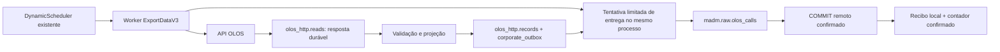

# Persistência corporativa no processo ExportDataV3

Esta implementação adapta o **mesmo processo** `dist/main.js start/admin/once`. O `DynamicScheduler` existente continua sendo o único agendador da captura OLOS. `src/corporate-delivery/` contém componentes auxiliares do Store; não tem entrada executável, timer, scheduler, worker, Compose ou container próprios. O Corporate Sync antigo é preservado, mas não é importado/iniciado pelo fluxo operacional.

## Fluxo implementado

`DATABASE_URL` continua apontando ao banco local. Não são gravadas novas chamadas em `raw.olos_calls` local no modo corporativo: o lote vem da resposta OLOS preservada em `olos_http.reads`, é validado e entra diretamente na outbox. A tabela local antiga é lida somente na conciliação inicial e sua sequência original continua alocando os IDs internos. Não existe polling da tabela local para replicação.

`reads.state='done'` e `processed_count` confirmam **validação e admissão durável local**, não entrega corporativa. `CorporateDelivery` confirma `corporate_outbox.state='confirmed'`, `remote_raw_id`, `confirmed_at` e o contador em `corporate_control` somente depois do COMMIT remoto confirmado. Os relatórios de captura usam `queued`, mantendo `inserted=0` para filas; o painel expõe `corporate_delivery` separadamente da captura.

Ao terminar cada ciclo do Worker, uma tentativa limitada pode entregar um lote pendente. Não há outro loop/timer de entrega. Essa tentativa usa conexão local separada da captura, uma conexão MADM própria e promessa acompanhada pelo Store; não bloqueia o próximo ciclo de captura. Uma tentativa ainda ativa impede outra no mesmo Store. Pausa/desligamento aguardam essa promessa antes de liberar o lock da origem.

O avanço da fila após autenticação OLOS indisponível pode ocorrer nos ciclos que o agendador existente ainda admite. Se esse agendador entrar em ERROR/STOPPED, a entrega não ganha um agendador alternativo: recuperar explicitamente pelo processo existente ou pelo comando pontual autorizado.

## Contrato MADM

- Banco obrigatório `madm`; destino fixo `raw.olos_calls`.
- `internal_id_olos integer`, UNIQUE parcial `WHERE internal_id_olos IS NOT NULL`.
- `raw_olos_call_id bigint GENERATED ALWAYS AS IDENTITY`, PK automática.
- `telefone_match_key` produzido pelo trigger corporativo; datas de carga/criação/atualização seguem defaults corporativos.
- O INSERT omite `raw_olos_call_id`, `telefone_match_key`, `kommo_*` e colunas de defaults corporativos.
- Não existe UPDATE/DELETE corporativo nem `ON CONFLICT DO UPDATE` nesse caminho.

Reutiliza as regras puras de `src/corporate-sync/mapping.ts` e o schema corporativo já descrito em `src/corporate-sync/schema.ts`. Valida PK, índice parcial, disponibilidade dos índices, identity ALWAYS, tipos, nulabilidade, comprimentos, defaults, trigger e funções de normalização. Na conciliação inicial persiste uma impressão do schema e das duas funções; divergências posteriores bloqueiam a entrega antes de INSERT. Nenhuma incompatibilidade é corrigida por DDL corporativo.

A identidade lógica continua sendo `(CallId, data_ligacao, telefone, campanha)`. Comparar o ID interno isoladamente ou apenas CallId é insuficiente. Antes de inserir, busca tanto o ID interno quanto a identidade composta. Se existir a mesma identidade em outro ID, ou o mesmo ID com outra chamada, bloqueia. Mesmo identidade/ID iguais exigem igualdade de todos os campos transferidos. `kommo_*`, campos automáticos e telefone normalizado não entram nessa igualdade.

Chamadas já idênticas são reconhecidas sem novo INSERT, sem executar novamente seu trigger e sem consumir outro valor da identity corporativa. Para linhas ausentes usa `ON CONFLICT (internal_id_olos) WHERE internal_id_olos IS NOT NULL DO NOTHING`; revalida o resultado na mesma transação SERIALIZABLE, nunca presume que o conflito é uma duplicata legítima.

A sequência **já existente** da tabela local é reutilizada via `pg_get_serial_sequence`. Não se cria sequência, não se executa setval, não se usa o ID OLOS como ID interno e não se realoca um registro após colisão. Valida a sequência contra os IDs locais já usados, rejeita ciclos/incrementos não positivos e valida cada novo ID no intervalo de integer. Outros produtores corporativos podem ocupar o mesmo espaço: nesse caso a comparação bloqueia o lote e preserva evidência, sem sobrescrever. Homologar a convivência e a capacidade restante desse espaço antes de ativar.

## TMA e tempo

A política `round-half-away` já foi aprovada no pedido e fica fixa neste modo, sem pedir uma nova aprovação de política:

| Valor | Inteiro corporativo |
| --- | --- |
| 0.001 / 0.49 / 0.499999 | 0 |
| 0.5 | 1 |
| 1.5 | 2 |
| -0.5 | -1 |

A duração das novas respostas OLOS é calculada em microssegundos e arredondada **uma vez** para integer. O comportamento anterior em centésimos permanece no modo local. Durações negativas ou dados ausentes mantêm a regra existente de NULL; limites de integer são verificados antes da entrega. O histórico conciliado usa sua projeção/recibo existente, sem recalcular e sobrescrever valores antigos.

`data_ligacao timestamptz` preserva o instante e os microssegundos. Se o destino real usar timestamp sem fuso, requer fuso explícito e `OLOS_CORPORATE_TIMESTAMP_CONFIRMATION=CONFIRM_TIMESTAMP_<fuso>`; a conversão é feita por `AT TIME ZONE`. Schema/precisão/fuso incompatíveis bloqueiam a ativação. O tipo temporal real não foi consultado nesta implementação.

## Como preservar os 12.605 registros

O novo padrão **12.605** vem da auditoria operacional da VPS informada pelo usuário, após o último lote legado de 500 registros ter concluído com sucesso via `once` do Corporate Sync. Os dados reportados são do banco local `olos_exportdata`, origem `olos-production`:

- `corporate_sync.control`: version 1, generation 27, last_confirmed_id 12605, confirmed_count 12605 e pending NULL.
- `corporate_sync.receipts`: 12605 recibos distintos, IDs de 1 a 12605.
- `olos_http.records`: 725284 registros rastreados.
- Sequência `raw.olos_calls_internal_id_olos_seq`: last_value 725284, is_called true.
- `olos_billing.sources`: 0 registros no momento da auditoria reportada; a proteção contra dependências Billing permanece ativa.

Essas informações foram fornecidas pelo usuário e não foram reconsultadas nesta atualização. Alterar o esperado não modifica checkpoints, recibos, sequência nem backlog. A regressão de **12.105 registros sintéticos** permanece preservada; o novo teste cobre 12.605 recibos e três registros sintéticos de backlog, sem simular o volume total de 725284 registros.

A conciliação administrativa é única, localmente transacional e exige evidência por registro:

1. Adquirir o lock original da origem OLOS e o advisory lock usado pelo Corporate Sync, impedindo os dois consumidores simultâneos.
2. Exigir ausência de capturas locais `reading`/`received` e de lote pendente em `corporate_sync.control`.
3. Confirmar o binding legado explicitamente configurado, `confirmed_count` e a contagem real dos recibos: devem corresponder ao esperado 12.605.
4. Relacionar cada recibo ao `target_id` de `olos_http.records`, preservando o `source_id` OLOS associado. O teste usa IDs de origem diferentes dos internos.
5. Projetar a chamada local, verificar seu hash contra o recibo e comparar identidade e campos transferidos com a chamada corporativa, em transação corporativa READ ONLY.
6. Adotar os recibos comprovados na nova outbox como confirmados, registrando a PK automática corporativa. Esses registros não são enviados novamente.
7. Migrar também registros históricos locais ainda sem recibo: se a chamada idêntica já existe no corporativo, reconhecê-la; caso contrário, preservar seu mesmo ID e projeção como pending. A transição não descarta o backlog.
8. Confirmar a transação remota de leitura e, somente depois, confirmar a transação local de adoção, schema e estado `ready`. A entrega continua pausada até comando explícito de retomada.

`corporate_sync.control`, `corporate_sync.receipts`, `olos_http.records`, respostas e checkpoints anteriores não são apagados ou reescritos. A migração local cria somente `olos_http.corporate_control`, `olos_http.corporate_outbox` e seu índice local. Repetir a conciliação depois de `ready` retorna o resultado persistido; não reinicializa fila nem recibos e não representa uma nova auditoria corporativa completa.

Hash diferente, mapping ausente, ID fora do intervalo, pendência antiga, chamada divergente/ausente, binding incompatível ou contagem inesperada impedem a adoção inteira. Não preencher recibos pela contagem, não inferir ID pelo CallId, não alterar o binding para passar e não ignorar registros problemáticos. Se o estado disponível não comprovar os 12.605, **a ativação deve ficar bloqueada**.

O estado persistente também impede iniciar novamente o Corporate Sync ou voltar acidentalmente ao modo de persistência local depois da transição. O código/serviço antigo não é removido nem iniciado por esta entrega.

Há uma incompatibilidade concreta com o Billing atual: `projectAttempts` verifica a presença do ID em `raw.olos_calls` **local** e marca conflito quando a chamada não existe ali. Por isso, se `olos_billing.sources.attempts_source` apontar para esta origem, a conciliação, admissão de captura, retomada e entrega direta bloqueiam com `BILLING_LOCAL_CALLS_DEPENDENCY`. Nenhum arquivo/configuração Billing é alterado. Se essa dependência existir em produção, manter a transição bloqueada até uma solução de contrato separadamente aprovada; não excluir/editar a configuração Billing para contornar a proteção. Auditar também consumidores locais externos ou ainda não registrados: a guarda não descobre automaticamente todos eles.

## Configuração e controles

O padrão permanece `ATTEMPTS_PERSISTENCE_MODE=local`. O modo novo é `corporate`, configurado no mesmo serviço ExportDataV3. Não reaproveita variáveis `CORPORATE_SYNC_*`. Ver [environment.example](environment.example), que não contém credenciais reais.

| Variável | Regra |
| --- | --- |
| `DATABASE_URL` | banco local existente; não trocar pelo MADM |
| `OLOS_CORPORATE_DATABASE_URL` | URL explícita, banco `/madm`, sem opções na query string |
| `OLOS_CORPORATE_CA_FILE` | CA corporativa montada somente leitura; opcional se a cadeia já for pública/confiável |
| `OLOS_CORPORATE_WRITE_ENABLED` | false por padrão |
| `OLOS_CORPORATE_WRITE_CONFIRMATION` | `AUTHORIZE_EXPORTDATA_DIRECT_DELIVERY` para habilitar escrita |
| `OLOS_CORPORATE_LEGACY_BINDING` | binding exato já existente em corporate_sync.control |
| `OLOS_CORPORATE_LEGACY_EXPECTED_COUNT` | 12605 por padrão; mudanças exigem evidência/decisão explícita |
| `OLOS_CORPORATE_RECONCILE_CONFIRMATION` | `AUTHORIZE_CORPORATE_STATE_RECONCILIATION` para adoção administrativa local |
| `OLOS_CORPORATE_BATCH_SIZE` | 250, entre 1 e 2000 |
| `OLOS_CORPORATE_TIMEOUT_MS` | 15000, conexão/statement/lock |
| `OLOS_CORPORATE_BACKOFF_MS` | 1000; backoff exponencial até 60 segundos |
| `OLOS_CORPORATE_MAX_FAILURES` | 5; após o limite, bloqueia somente entrega até retomada explícita |
| `DB_POOL_MAX` | precisa ser pelo menos 2 no modo corporativo |

TLS corporativo sempre valida certificado e hostname. Não há opção para desabilitar SSL/validação; `OLOS_CORPORATE_TLS_VERIFY=false` é rejeitado. Nunca colocar credenciais no código, comandos de teste, logs ou Git. A conexão local segue a configuração operacional existente.

Comandos adicionados ao **mesmo** `dist/main.js`, sem autenticar/consumir OLOS:

| Comando | Uso |
| --- | --- |
| `corporate-status` | contagens/estado locais, sem conexão MADM |
| `corporate-check` | valida binding e schema atual em leitura; exige estado conciliado |
| `corporate-reconcile` | concilia/adota o legado; requer origem parada, confirmações e leitura MADM |
| `corporate-pause` | pausa somente entrega; captura pode continuar |
| `corporate-resume` | retoma entrega com autorização; pode rearmar falha transitória/COMMIT incerto após esgotar tentativas |
| `corporate-deliver-once` | uma tentativa de um lote, respeitando pausa/backoff; exige o lock da origem e não concorre com o serviço ativo |

Status/check/pause/resume usam uma conexão de controle local independente e podem operar com o worker ativo. Pausa espera a transação de entrega atual terminar antes de retornar; não abandona um commit em curso. Um bloqueio estrutural, de identidade ou payload não é apagado por resume. Requer investigação e resolução com evidência, fora de um mecanismo automático de “pular erro”.

Pausar o agendador existente suspende admissão de novas entregas e espera a atual; retomar o agendador respeita a pausa persistida da entrega. Parar/desligar fecha os recursos depois da confirmação em andamento. SIGKILL/timeout do container pode interromper esse caminho; a recuperação usa a outbox persistida. Dimensionar o grace period para o lote, latência e timeouts antes de homologar operação.

## Falhas, recuperação e limites

- Falha corporativa não altera a resposta OLOS já persistida e não transforma o ciclo em erro de captura. A fila continua recebendo chamadas; tentativas e backoff ficam no controle de entrega.
- Falha antes do COMMIT remoto: não há confirmação local; revalida e tenta o mesmo payload depois.
- Falha ao confirmar COMMIT, inclusive desconexão sem SQLSTATE: registra `CORPORATE_COMMIT_UNKNOWN`. Pending significa resultado ainda não comprovado localmente, e não necessariamente ausência no corporativo.
- Falha depois do COMMIT remoto e antes/durante o COMMIT local: o payload fica pending ou já confirmado, conforme o resultado local. O reinício lê esse estado e reconhece somente a chamada corporativa exata. Não há transação distribuída atômica.
- Falha local ou perda do dono do lock continua sendo fatal para a captura, conforme o protocolo anterior. Não mascarar essa falha como simples indisponibilidade corporativa.
- Retentativas são acionadas pelos ciclos já admitidos e respeitam `next_attempt_at`, calculado pelo PostgreSQL local. Não há novo scheduler nem retry automático de uma leitura consumptiva OLOS incerta.
- A implementação replica inserções, não alterações posteriores. Payloads ficam congelados; enriquecimentos posteriores não modificam chamadas corporativas existentes.
- A fila não tem descarte automático. Provisionar capacidade local, monitorar pending, tentativas, duração e crescimento de respostas/outbox. Uma indisponibilidade longa pode consumir disco; falta de capacidade local exige intervenção operacional.
- Restauração corporativa anterior aos recibos locais exige reconciliação coordenada. O código não presume que chamadas confirmadas continuam existindo após restauração externa nem apaga recibos para reenviar.
- Não existe garantia de unicidade lógica contra outros escritores que não participam deste protocolo. O índice corporativo protege IDs internos; diferenças e colisões observadas bloqueiam.

Logs têm somente eventos, contagens, tentativas, duração/códigos fixos e UUIDs de captura já usados no worker. Sem credenciais, SQL, detalhes de erro PostgreSQL, CPF, e-mail, telefone ou conteúdo de payload. Respostas e outbox locais contêm dados pessoais necessários à recuperação: proteger acesso, disco e backups.

## Validação da release sem Billing

O Corporate Delivery não importa arquivos de `src/billing/` nem exige suas migrations. A guarda de compatibilidade consulta a existência de `olos_billing.sources` e só verifica dependências se essa tabela já existir; sua ausência não impede o funcionamento. O teste dessa guarda cria uma fixture mínima própria, sem carregar o módulo Billing.

Com Node 24 e dependências instaladas, executar `npm run typecheck`, `npm run build` e `node --import tsx --test test/corporate-delivery.test.ts`. O comando `bash scripts/test-corporate-delivery.sh` provisiona PostgreSQL descartável e executa integração Corporate Delivery, regressões Store e administração. Não provisiona nem executa a suíte Billing. Antes de criar bancos, verifica rede interna, ausência de portas publicadas e identidade do container temporário; ao terminar remove container, dados e rede. Não usa URLs reais do ambiente. A fixture inclui os cenários legados de 12105 e 12605 registros.

Para validar uma publicação seletiva, exportar somente o índice Git para um diretório vazio com `git checkout-index --all --prefix=<diretório-absoluto>/`, instalar dependências ali e executar os comandos nesse diretório. Construir a imagem com o Dockerfile existente a partir desse mesmo snapshot. Não copiar arquivos não staged do checkout original, ambientes reais ou artefatos `dist` anteriores.

## Homologação e ativação futuras — não executadas

1. Executar os testes descartáveis e revisar o relatório. Não usar bancos reais para testes/falhas injetadas.
2. Em janela separadamente autorizada, confirmar a identidade dos serviços/bancos, fazer backup de respostas, `records`, controles/recibos antigos, sequência e configuração. Verificar dependências do Billing e de outros consumidores da tabela local; a dependência Billing registrada bloqueia a transição. Não modificar o Environment do Dokploy durante esta implementação.
3. Parar de forma controlada a captura e o Corporate Sync anterior. Não iniciar o Sync separado para este fluxo. Resolver leituras/pending antigos pelo procedimento vigente antes de trocar de modo; não apagar evidências.
4. Aplicar manualmente **somente no banco local** `migrations/002_corporate_delivery.sql`, com identidade autorizada. Não há migration corporativa. Verificar que o runtime já possui permissões necessárias; não executar GRANT corporativo por este código.
5. Preparar a configuração do mesmo serviço com modo corporate, URL/CA explícitas, binding legado e contagem esperada, ainda com escrita false. Confirmar tipo temporal/fuso reais.
6. Com autorização específica de leitura corporativa e adoção local, executar `node dist/main.js corporate-reconcile`. Se falhar qualquer prova, manter a ativação bloqueada. Não substituir o esperado por uma contagem conveniente.
7. Executar `corporate-status` e `corporate-check`. Revisar 12.605 adotados, backlog, schema, trigger, PK, TMA, capacidade de IDs, TLS, planos de consulta, latência e coexistência com escritores corporativos. A fixture não certifica o schema real.
8. Somente com autorização de escrita, habilitar as duas variáveis de escrita e executar `corporate-resume`. Homologar um lote pequeno pelo processo existente; conferir PK automática, normalização, campos Kommo, recibos e ausência de duplicação. Esses passos escrevem dados reais e não foram executados aqui.
9. Retomar o agendador atual, acompanhar captura e entrega separadamente e dimensionar o lote sem criar outro serviço ou scheduler.

Rollback operacional seguro: pausar entrega e/ou parar o mesmo worker, manter o modo/configuração coerente com o estado adotado e preservar outbox/recibos. Não voltar simplesmente ao modo local nem reiniciar o Sync antigo; as proteções impedem esse retorno porque ele pode perder IDs/entregas pendentes. Retorno ao protocolo antigo exige plano específico de conciliação. Não deletar chamadas MADM, não executar down migration e não limpar o marcador de ownership para contornar o bloqueio.
