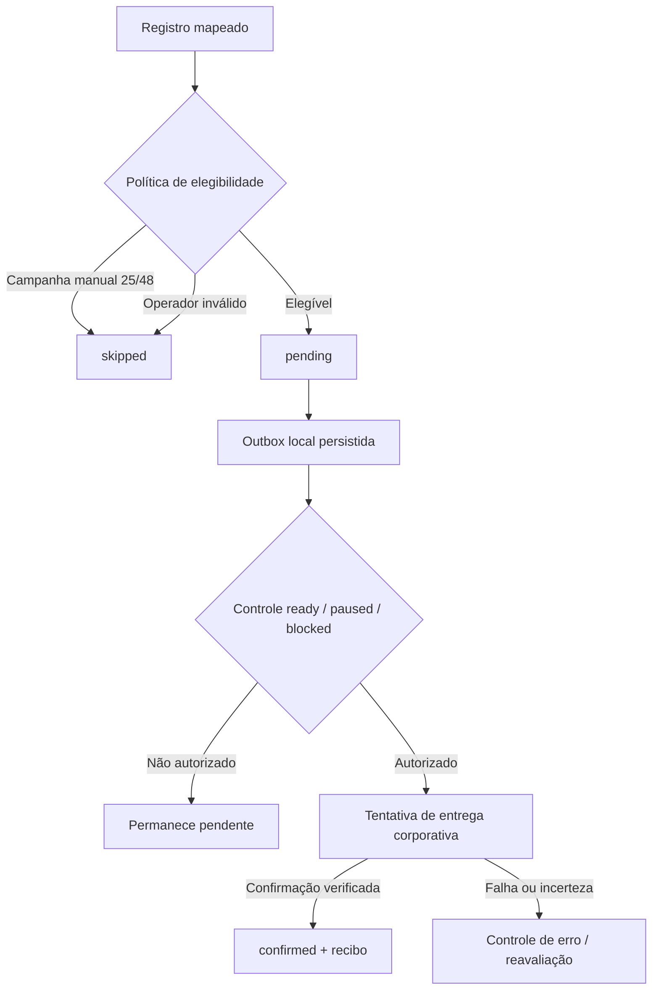

# Entrega corporativa e outbox

[Início](../README.md) / Backend

## Finalidade

Garantir que a etapa de encaminhamento dos registros elegíveis ao banco corporativo seja **durável, auditável e separada da captura da OLOS**. A fila local `olos_http.corporate_outbox` conserva payload e hash; a confirmação é representada por dados de recibo (`confirmed_at`, `remote_raw_id`).

## Fluxo

## Política de elegibilidade observada

**Campanhas IDs `25` e `48`:** `skipped`, com `delivery_policy_code='MANUAL_CAMPAIGN_EXCLUDED'`. **Operador:** exige `agent_id` numérico positivo e `nome_agente` textual não vazio e não-placeholder. Registros fora dos critérios são `skipped`; outros podem ingressar como `pending`.

## Estados da outbox

| Estado | Significado |
|---|---|
| `pending` | Entrada durável aguardando tentativa/confirmação |
| `confirmed` | Recibo local íntegro com `confirmed_at` e `remote_raw_id` |
| `skipped` | Excluído da entrega por regra de elegibilidade |

A migration `003` estende os estados originalmente `pending` e `confirmed` para permitir `skipped`; a `005` acrescenta `delivery_policy_code`.

## Controle e limites

A tabela `corporate_control` guarda `ready`, `paused`, `blocked`, `failure_count`, `next_attempt_at`, `last_code` e totais. **`ready=true` não comprova conexão ou escrita efetuada no destino**. O método `attempt()` é acionado de forma controlada por ciclo/comando; não há autorização para ativar outra instância concorrente.

## Segurança da informação

O payload da outbox pode conter **dados pessoais**. Não exiba a coluna `payload` em logs, documentação pública ou prints operacionais. A tabela é local; migrations de entrega não devem executar DDL no MADM.

**Veja:** [Indicadores](../referencia/indicadores.md) · [Recuperação](recuperacao.md).
