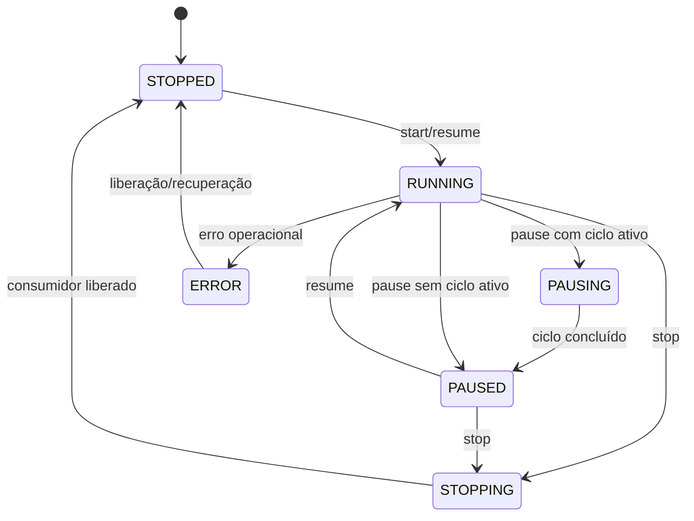

# Scheduler e execução dinâmica

[Início](../README.md) / Backend

## Responsabilidade

O `DynamicScheduler` registra o estado solicitado, mantém o estado efetivo e coordena a admissão de ciclos de ingestão. A frequência configurável é de **60.000 a 3.600.000 ms** (1–60 minutos).

## Estado solicitado x real

O usuário envia um **comando**; o backend persiste `desired_state`. O estado `runtime_state` muda durante a aplicação efetiva. Comandos `POST /api/worker/*` retornam `202` para solicitação aceita.

## Transições relevantes

*O desenho resume transições identificadas; não é uma enumeração exaustiva de todos os caminhos de erro.*

## Recuperação contínua

A release auditada possui `OLOS_SCHEDULER_CONTINUOUS_RECOVERY=true`. Isso configura comportamento de recuperação do scheduler; **não autoriza** resolver automaticamente qualquer leitura remota ambígua.

## Boas práticas

- Aguarde conclusão do ciclo ao pausar/parar.
- Não trate `scheduler_started` isoladamente como prova de `RUNNING`; confirme `runtime_state`.
- Não altere agendamento por tentativa e erro em produção.
- Diferencie um ciclo vazio (`received=0`) de uma interrupção do scheduler.
