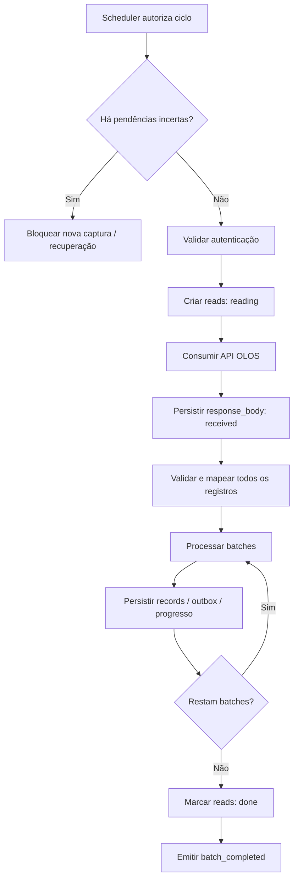

# Worker de ingestão

[Início](../README.md) / Backend

## Ciclo de processamento

## Identidade, lote e progresso

A chave lógica local do registro é `(source_key, source_id)`. O `Store` processa batches configuráveis: o valor padrão observado no código é **500**, com intervalo aceito de **1 a 2.000**. A cada batch, atualiza `processed_count` e a persistência correspondente.

## Otimizações vigentes na imagem auditada

- **Map once:** cada resposta é mapeada integralmente uma vez e reutilizada nos batches.
- **Consulta consolidada de duplicidades:** consulta de IDs existentes por conjunto.
- **Alocação de IDs em lote:** uso de `generate_series` para obter IDs necessários.
- **Freeze em lote:** construção do payload corporativo validado em uma operação em lote.
- **INSERTs individuais restantes:** a auditoria anterior identificou inserts por item na fase de enqueue; não há evidência de substituição por inserts completamente em lote nessa release.

## Resultados por ciclo

`batch_completed` fornece `read_id`, `received`, `inserted`, `updated`, `duplicates`, `queued`, `skipped`, `request_ms`, `persistence_ms` e `duration_ms`, conforme disponibilidade. Esses valores pertencem **àquele ciclo**, não ao total de chamadas da MADM.

## Semântica de falhas

Uma resposta recebida e armazenada pode ser drenada posteriormente. Uma leitura `reading` sem confirmação do resultado remoto exige reconciliação específica. Consulte [Recuperação](recuperacao.md).
