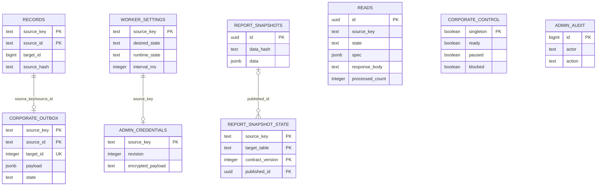

# Modelo de dados e relacionamentos

[Início](../README.md) / Banco de dados

## Banco local

A infraestrutura auditada utiliza **PostgreSQL 16**, schema `olos_http`. As migrations foram projetadas para **aplicação manual** e não devem ser aplicadas automaticamente em inicialização produtiva.

## Relações formais

- `corporate_outbox(source_key,source_id)` referencia `records(source_key,source_id)`.
- `admin_credentials.source_key` referencia `worker_settings.source_key`.
- `report_snapshot_state.published_id` referencia `report_snapshots.id`.
- `records(source_key,source_id)` é chave composta; `(target_table,target_id)` possui restrição de unicidade.

## Integridade

`reads` restringe estados a `reading`, `received`, `done`, `resolved`, exige `response_body` para `received` e `done`, e `resolution` para `resolved`. A outbox exige hash SHA-256 hexadecimal e recibo consistente para `confirmed`. Os snapshots incluem validação de estrutura, hash e trigger que impede updates nos dados já publicados.

## Limite do desenho

Este ERD mostra **chaves estrangeiras explicitamente encontradas nas migrations**. Relações apenas lógicas, sem FK, não são exibidas como relacionamentos físicos.

**Próximo:** [Tabela a tabela](tabelas.md).
