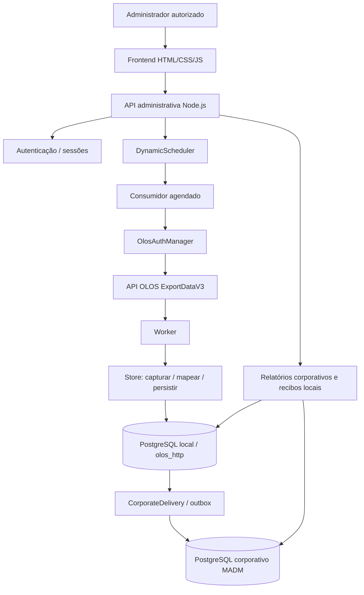

# Arquitetura da solução

[Início](../README.md) / Introdução

## Visão lógica

## Limites transacionais

- **Captura da origem:** uma intenção `reading` é persistida antes da chamada potencialmente consumidora. A resposta é armazenada como `received` antes de processá-la.
- **Persistência local:** batches atualizam registros, outbox e progresso sob controle transacional.
- **Entrega corporativa:** é uma etapa distinta; o recebimento pela origem não equivale a `confirmed`.
- **Relatórios:** fontes e janelas temporais variam. O relatório corporativo ativo consulta `raw.olos_calls` no MADM e recibos locais, sem depender do atualizador de snapshots local.

## Componentes de código

| Caminho | Papel |
|---|---|
| `src/admin/main.ts` | Inicialização do Admin, API e scheduler |
| `src/admin/server.ts` | Rotas e segurança HTTP do painel |
| `src/admin/repository.ts` | Configuração, observações e auditoria PostgreSQL |
| `src/admin/reports.ts` | Leitura de snapshots e contagem local |
| `src/admin/corporate-daily.ts` | Consulta histórica ao MADM |
| `src/worker.ts` | Ciclos, captura e relatórios operacionais |
| `src/api.ts` / `src/auth.ts` | Integração HTTP e tokens OLOS |
| `src/store.ts` | Persistência, recuperação e progresso |
| `src/corporate-delivery/delivery.ts` | Outbox e entrega corporativa |
| `src/scheduler.ts` | Estados e agendamento dinâmico |

## Implantação

Na auditoria, a execução estava em containers Dokploy/Docker: Admin com imagem específica do projeto e PostgreSQL 16. Consulte [ambiente produtivo](../operacao/ambiente-producao.md) para os nomes registrados, sem presumir que todos os detalhes permaneçam iguais em releases futuras.
